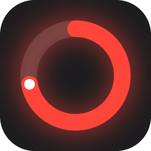
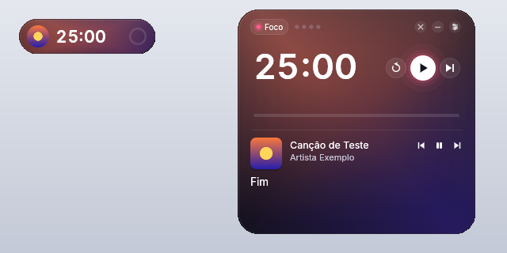
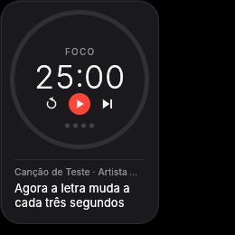

# Halo

Um pomodoro flutuante, bonito e minúsculo para Windows, Linux e macOS, com a música que está tocando e a letra sincronizada.




- **Leve de verdade:** um único executável (5–10 MB), sem navegador nem WebView por baixo.
  Com o timer parado, não gasta CPU. Rodando, redesenha uma vez por segundo.
- **Flutuante:** fica por cima das outras janelas, sem borda. Arraste por qualquer lugar.
- **Dois estilos visuais**
  - **Clássico:** superfícies sólidas e discretas, botões vermelho/amarelo/verde.
  - **Fluido:** gradiente vivo que muda de cor com a fase, vidro, anel com brilho, números que rolam
    e transições suaves. Inspirado em apps como Arc, Raycast e Dia.
- **Muito personalizável:** 16 temas prontos, todas as cores editáveis, quatro layouts (Anel, Pílula, Mínimo
  e Ilha, que se abre ao passar o mouse), tamanho, cantos, opacidade, fonte (Inter embutida, do sistema
  ou qualquer .ttf), peso dos números, modo Zen, efeito vidro nativo (Windows/macOS) e o que aparece ou não na tela.
- **Sons próprios:** Sino, Gota, Madeira, Cristal, Acorde, Digital e Tigela tibetana, criados pelo próprio app,
  um para o fim do foco e outro para o fim da pausa (`cargo run --example dump_sounds -- pasta` grava todos para ouvir).
- **Tocando agora + letra sincronizada:** mostra a música do sistema (Spotify, navegador, etc.) com a capa,
  a letra estilo karaokê (ou uma linha só) e, no estilo Fluido, o gradiente com as cores da capa. A linha
  atual da letra, buscada no [LRCLIB](https://lrclib.net) e, se você colar uma chave grátis, no
  [Vagalume](https://www.vagalume.com.br/api/). Controles de anterior, play/pausa e próxima ao passar o mouse.
- **Histórico:** focos de hoje, sequência de dias, meta diária, gráfico da semana e grade das últimas 16 semanas.
- **Bandeja do sistema:** o ícone mostra o progresso do timer, a dica mostra o tempo restante e o menu
  inicia, pausa, pula e abre as Preferências. Dá para minimizar o Halo para lá.
- **Atualização automática** com as novidades de cada versão (Preferências → Sobre).
- Tudo fica salvo: configurações, tema, histórico e posição da janela.

## Como usar

| Ação                 | Como                                     |
|----------------------|------------------------------------------|
| Iniciar / pausar     | Clique no timer ou `Espaço`              |
| Reiniciar fase       | `R`                                      |
| Pular fase           | `S`                                      |
| Mover                | Arraste                                  |
| Preferências         | Botão direito, `Ctrl/⌘ + ,` ou o botão que aparece ao passar o mouse |
| Sair                 | `Ctrl/⌘ + Q`                             |

Os controles somem enquanto o timer roda e voltam quando o mouse passa por cima (dá para desligar isso).


## Download

Na página de **Releases**:

- **Windows:** `halo-setup-windows-x64.exe` (instalador, recomendado) ou `halo-windows-x64.exe` (portátil).
  O instalador não pede administrador, cria atalho no menu Iniciar e tem a opção de abrir junto com o Windows.
  Na primeira vez o Windows pode avisar que o app não é reconhecido: clique em **Mais informações → Executar assim mesmo**.
- **Linux:** `halo-linux-x64` (rode `chmod +x halo-linux-x64` antes)
- **macOS:** `halo-macos-arm64` (Apple Silicon) ou `halo-macos-intel`

> No macOS o binário não é assinado. Na primeira vez, clique com o botão direito → Abrir.

## Se algo der errado

O Halo grava um log em:

- Windows: `%LOCALAPPDATA%\Halo\halo.log`
- macOS: `~/Library/Application Support/Halo/halo.log`
- Linux: `~/.local/share/halo/halo.log`

Também dá para abrir a pasta em Preferências → Sobre.

Se a janela não abrir com OpenGL (comum em computadores antigos), o Halo tenta sozinho outros modos:
OpenGL sem transparência, DirectX e, por último, desenho por software (WARP, que funciona em qualquer
Windows 10 ou mais novo). Ele lembra o modo que funcionou. Se o driver travar o processo de vez,
abra o Halo de novo: ele pula o modo que falhou. Para forçar um modo, use a variável de ambiente
`HALO_RENDERER` (`glow`, `glow-opaco`, `directx` ou `software`).

## Compilar

Precisa do [Rust](https://rustup.rs).

```bash
cargo run --release
```

No Linux, instale antes: `libxkbcommon-dev libgl1-mesa-dev libwayland-dev libssl-dev pkg-config`.

A cada push na `main`, o GitHub Actions compila os três sistemas, gera o instalador do Windows e publica
(ou atualiza) a release com a versão do `Cargo.toml`. As notas da release vêm da seção daquela versão no
`CHANGELOG.md`, e o próprio app mostra essas novidades depois de atualizar.

Para lançar uma versão nova: suba o `version` no `Cargo.toml` e escreva a seção dela no topo do `CHANGELOG.md`
(um teste garante que os dois batem).

O ícone é desenhado em código (`src/icon.rs`). Depois de mudar o desenho, gere de novo os arquivos com
`cargo run --example make_icon`.

## Por que não Tauri/Electron?

Tauri usa a WebView do sistema. No Windows isso é o WebView2 (Chromium), que sobe vários processos e
costuma ocupar 50–100 MB de RAM. Aqui a interface é desenhada direto com [egui](https://github.com/emilk/egui)
via OpenGL, num processo só. Ícones, gradientes e brilhos são desenhados com formas e malhas simples,
então não há imagens nem fontes de ícone embutidas. A fonte é lida do próprio sistema.

As animações do estilo Fluido (números rolando, troca de cor) rodam por uma fração de segundo
a cada mudança e podem ser desligadas em Preferências → Aparência.

## Música e letras



| Sistema | De onde vem a música | Observação |
|---------|----------------------|------------|
| Windows | Controles de mídia do Windows (os mesmos do painel de volume) | Funciona com Spotify, navegadores, Música… |
| Linux   | MPRIS (D-Bus) | Spotify, navegadores, VLC, Rhythmbox, Elisa… |
| macOS   | AppleScript | Spotify e Música. Na primeira vez o macOS pede permissão. |

A leitura roda numa thread separada, uma vez por segundo. A tela só é redesenhada quando a linha da letra
muda. Dá para desligar tudo em Preferências → Música.

Para testar no Linux sem um player de verdade, há um player MPRIS falso:

```bash
dbus-run-session -- sh -c 'cargo run --example mock_player & sleep 1; cargo run'
```

`HALO_LYRICS_API` e `HALO_VAGALUME_API` apontam as letras para outros servidores compatíveis (útil em testes).

O Letras.mus.br não tem API pública e copiar letras do site vai contra os termos de uso dele, por isso
o Halo não busca lá.

## Estrutura

```
src/
  main.rs     cria a janela
  app.rs      janela principal: layouts, interação, animações, painel de música
  prefs.rs    janela de Preferências
  timer.rs    lógica do pomodoro (sem UI, com testes)
  stats.rs    histórico de focos por dia
  media.rs    música tocando no sistema (Windows, Linux, macOS)
  lyrics.rs   letras sincronizadas (LRCLIB) e leitura de .lrc
  theme.rs    temas, estilos e tudo que é personalizável
  widgets.rs  ícones, anel, interruptor, controle segmentado…
  fluid.rs    gradiente, vidro e brilho do estilo Fluido
  fonts.rs    carrega a fonte do sistema ou um arquivo
  glass.rs    desfoque nativo (Windows/macOS)
  sound.rs    aviso sonoro usando o som do próprio sistema
  tray.rs     ícone na bandeja com o progresso
  update.rs   atualização automática e novidades
  render.rs   escolha do renderizador, com planos B, C e D
  logging.rs  log em arquivo e captura de travamentos
  icon.rs     desenho do ícone
  art.rs      capa do álbum e cores dominantes
assets/fonts/ Inter (recortada para o alfabeto latino; licença OFL)
installer/    instalador do Windows (Inno Setup)
CHANGELOG.md  novidades de cada versão
```
