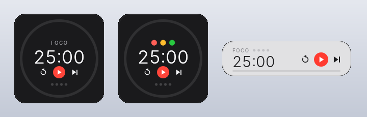
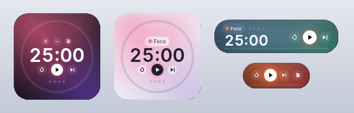
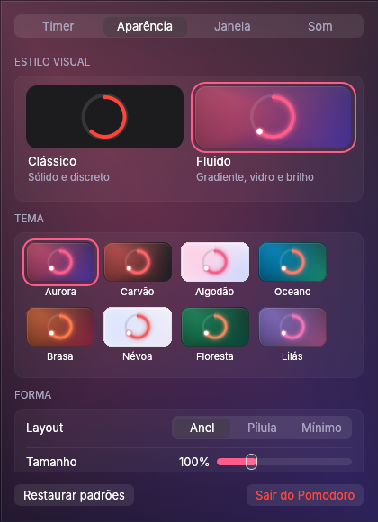

# Pomodoro

Um pomodoro flutuante, bonito e minúsculo para Windows, Linux e macOS.




- **Leve de verdade:** um único executável de ~6 MB, sem navegador nem WebView por baixo.
  Com o timer parado, não gasta CPU. Rodando, redesenha uma vez por segundo.
- **Flutuante:** fica por cima das outras janelas, sem borda. Arraste por qualquer lugar.
- **Dois estilos visuais**
  - **Clássico:** superfícies sólidas e discretas, botões vermelho/amarelo/verde.
  - **Fluido:** gradiente vivo que muda de cor com a fase, vidro, anel com brilho, números que rolam
    e transições suaves. Inspirado em apps como Arc, Raycast e Dia.
- **Muito personalizável:** 16 temas prontos, todas as cores editáveis, três layouts (Anel, Pílula, Mínimo),
  tamanho, cantos, opacidade, fonte (do sistema, embutida ou qualquer .ttf), peso dos números,
  efeito vidro nativo (Windows/macOS), som personalizado e o que aparece ou não na tela.
- Tudo fica salvo: configurações, tema e posição da janela.

## Como usar

| Ação                 | Como                                     |
|----------------------|------------------------------------------|
| Iniciar / pausar     | Clique no timer ou `Espaço`              |
| Reiniciar fase       | `R`                                      |
| Pular fase           | `S`                                      |
| Mover                | Arraste                                  |
| Preferências         | Botão direito, `Ctrl/⌘ + ,` ou o botão que aparece ao passar o mouse |
| Sair                 | `Ctrl/⌘ + Q`                             |

Os controles somem enquanto o timer roda e voltam quando o mouse passa por cima (dá para desligar isso).



## Download

Baixe o executável do seu sistema na página de **Releases**:

- Windows: `pomodoro-windows-x64.exe`
- Linux: `pomodoro-linux-x64` (rode `chmod +x pomodoro-linux-x64` antes)
- macOS: `pomodoro-macos-arm64` (Apple Silicon) ou `pomodoro-macos-intel`

> No macOS o binário não é assinado. Na primeira vez, clique com o botão direito → Abrir.

## Compilar

Precisa do [Rust](https://rustup.rs).

```bash
cargo run --release
```

No Linux, instale antes: `libxkbcommon-dev libgl1-mesa-dev libwayland-dev`.

Para gerar uma release, crie uma tag `v*` (ex.: `git tag v0.2.0 && git push --tags`) e o GitHub Actions
compila e publica os binários dos três sistemas.

## Por que não Tauri/Electron?

Tauri usa a WebView do sistema. No Windows isso é o WebView2 (Chromium), que sobe vários processos e
costuma ocupar 50–100 MB de RAM. Aqui a interface é desenhada direto com [egui](https://github.com/emilk/egui)
via OpenGL, num processo só. Ícones, gradientes e brilhos são desenhados com formas e malhas simples,
então não há imagens nem fontes de ícone embutidas. A fonte é lida do próprio sistema.

As animações do estilo Fluido (números rolando, troca de cor) rodam por uma fração de segundo
a cada mudança e podem ser desligadas em Preferências → Aparência.

## Estrutura

```
src/
  main.rs     cria a janela
  app.rs      janela principal: layouts, interação, animações
  prefs.rs    janela de Preferências
  timer.rs    lógica do pomodoro (sem UI, com testes)
  theme.rs    temas, estilos e tudo que é personalizável
  widgets.rs  ícones, anel, interruptor, controle segmentado…
  fluid.rs    gradiente, vidro e brilho do estilo Fluido
  fonts.rs    carrega a fonte do sistema ou um arquivo
  glass.rs    desfoque nativo (Windows/macOS)
  sound.rs    aviso sonoro usando o som do próprio sistema
```

## Ideias para o futuro

- **Música tocando agora:** no Windows pela API de mídia do sistema (GSMTC), no Linux via MPRIS (D-Bus),
  no macOS via MediaRemote. Vira um módulo novo (`src/media.rs`) e um layout a mais.
- **Letras sincronizadas:** buscar no [LRCLIB](https://lrclib.net) (API aberta, sem chave) pelo artista/título.
- Estatísticas simples de focos por dia.
